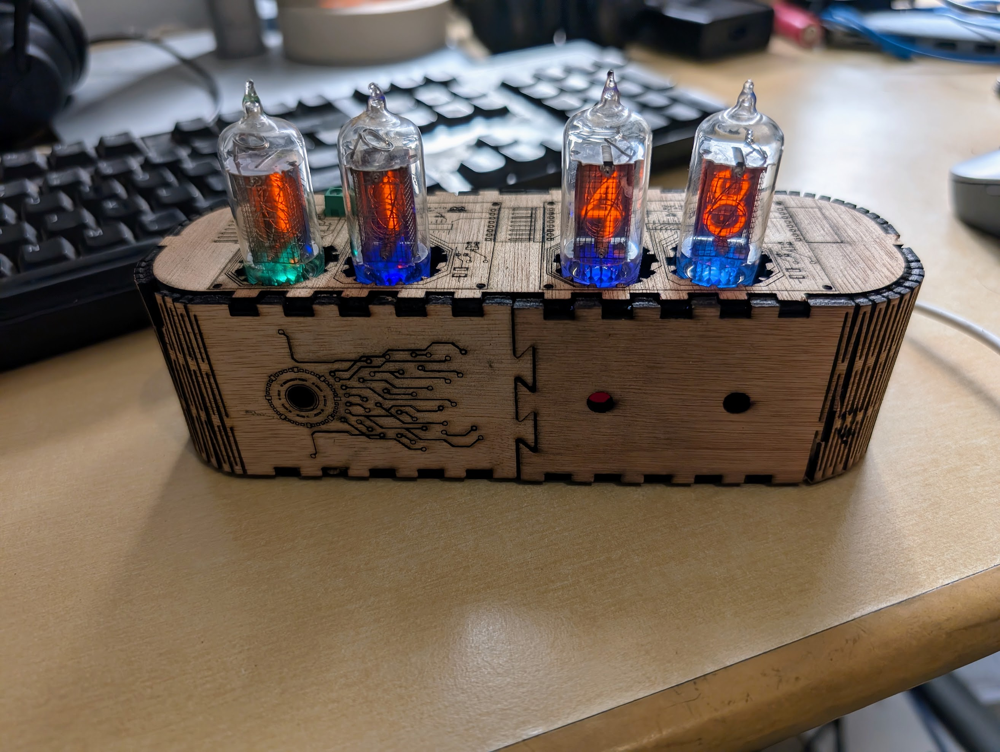
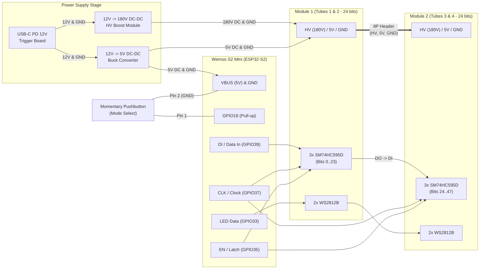
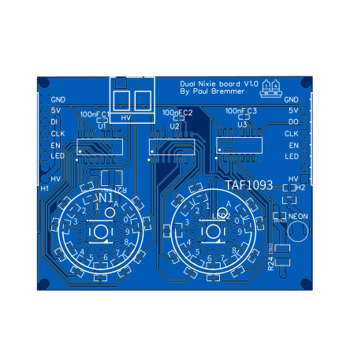

# Nixie1093 — Modular ESPHome Nixie Tube Clock & Display (`TAF1093` / `TAF1317A` / `Z570M`)



An ESPHome-powered modular Nixie tube clock and Home Assistant display built around daisy-chainable 2-digit **`TAF1093` / `TAF1317A`** (and `Z570M` / `ZM1080` B13D-compatible) Nixie PCB modules driven by **SM74HC595D** shift registers, **LMBTA42** high-voltage NPN transistors, and **WS2812B** addressable RGB tube backlighting.

---

## ✨ Features

- **Modular Daisy-Chainable PCB (`TAF1317A`)**: Each PCB module holds **2x `TAF1093` / `TAF1317A` / `Z570M` Nixie tubes**, **1x neon decimal/colon dot**, **2x WS2812B RGB LEDs**, and **3x SM74HC595D** 8-bit shift registers (24 bits per 2-digit module). Multiple modules plug directly into each other side-by-side via right-angle 8-pin male/female headers.
- **100% Self-Contained ESPHome Configuration**: No external C++ header files or deprecated `custom` components required—runs natively on **ESP-IDF** (`ESPHome 2026+`) on **ESP32-S2 (`lolin_s2_mini`)** or **ESP32-C6**.
- **Smooth 100 Hz PWM Crossfading**: Because the `SM74HC595D` double-buffers its shift register and storage latch (`EN`), unchanged tubes remain 100% solid with zero blanking while changing digits smoothly crossfade over 250 ms.
- **Multiple Display Modes (Home Assistant & Optional Pushbutton)**:
  - **Time (`HHMM`)**: Automatically syncs with Home Assistant (`Europe/Amsterdam`) and updates every minute.
  - **Power Usage**: Live home power consumption in Watts (`sensor.power_delivered * 1000`).
  - **Manual**: Display any custom integer (`0`–`9999`) from Home Assistant or automations.
  - **Test Cycle**: Cycles all tubes through `0000`, `1111`, …, `9999` every second for cathode exercising and testing.
- **Custom Nixie Backlight Effects**:
  - `Random color` *(Default at 50% brightness on startup)*
  - `Synthwave Sunset Drift` *(Warm Amber $\rightarrow$ Crimson $\rightarrow$ Magenta $\rightarrow$ Deep Violet)*
  - `Warm Nixie Ember` *(Organic per-tube warm neon/amber ember flicker)*
  - `Cyberpunk Neon Drift` *(Electric Cyan $\rightarrow$ Royal Blue $\rightarrow$ Ultraviolet $\rightarrow$ Neon Magenta)*
  - `Aurora Borealis` *(Dual-phase non-repeating northern lights drift)*
  - `Power Usage Traffic Light` *(Shifts from Soft Green/Teal at $0\text{ W}$ $\rightarrow$ Amber at $1000\text{ W}$ $\rightarrow$ Deep Red at $3000\text{ W}$)*
  - `Vacuum Tube Flicker` *(Subtle 10% filament shimmer)*

---

## 🧰 Required External Hardware

In addition to the assembled `TAF1317A` Nixie PCB modules (see [PCB & Bill of Materials](#-pcb--bill-of-materials-taf1317a) below), the clock uses the following off-the-shelf modules for power delivery, microcontroller control, and optional mode switching:

| Component | Specification / Role | Reference / Link |
| :--- | :--- | :--- |
| **Microcontroller** | **Wemos Lolin S2 Mini (`ESP32-S2FH4`)** (or ESP32-C6) | Runs ESPHome (`nixie1093.yaml` / `nixie1093-button.yaml`) |
| **USB-C PD Trigger Board** | **12V DC USB-C PD Decoy / Trigger Module** | Requests 12V DC from a USB-C Power Delivery wall adapter |
| **12V $\rightarrow$ 180V DC-DC Boost Converter** | **High-Voltage Nixie Power Supply Module** (Input: 12V DC, Output: ~170V–180V DC adjustable) | [AliExpress — DC-DC 180V Nixie Boost Converter Module](https://nl.aliexpress.com/item/1005006439043012.html) |
| **12V $\rightarrow$ 5V DC-DC Buck Converter** | **Step-Down Regulator Module** (Input: 12V DC, Output: 5V DC) | Powers the ESP32 (`VBUS`) and the Nixie board `5V` rail (`SM74HC595D` + `WS2812B` LEDs) |
| **Momentary Pushbutton** *(Optional)* | **Normally-Open (NO) Tactile / Panel Button** | Used with [`nixie1093-button.yaml`](nixie1093-button.yaml) (`GPIO18` to `GND`) to cycle display modes |

---

## 🔌 Hardware Architecture & Wiring

### System Power & Signal Diagram



### 1. Power Supply Connections

> [!CAUTION]
> The **180V DC** output of the high-voltage boost converter can deliver a painful shock and will instantly destroy the ESP32 or 5V logic if shorted to the `5V` or GPIO pins. Double-check all wiring before plugging in USB-C power.

| Source Module | Source Pin | Destination Module(s) | Destination Pin | Notes |
| :--- | :--- | :--- | :--- | :--- |
| **12V USB-C PD Trigger** | `V+` (`+12V`) | **180V HV Boost** & **5V Buck Converter** | `VIN+` / `IN+` | Main 12V DC bus |
| **12V USB-C PD Trigger** | `V-` (`GND`) | **180V HV Boost**, **5V Buck**, **ESP32**, **Nixie PCB** | `GND` / `IN-` / `G` | Common Ground shared across all modules |
| **12V $\rightarrow$ 180V HV Boost** | `HV+` (`VOUT+`) | **Nixie PCB Module 1** | **`HV`** (Screw Terminal / Header) | Adjusted to **170V–180V DC** for `Z570M` tubes |
| **12V $\rightarrow$ 180V HV Boost** | `GND` (`VOUT-`) | **Nixie PCB Module 1** | **`Ground`** | High-voltage return (common with logic `GND`) |
| **12V $\rightarrow$ 5V Buck Converter** | `VOUT+` (`+5V`) | **Wemos S2 Mini** & **Nixie PCB Module 1** | **`VBUS`** (ESP32) & **`5V`** (Nixie PCB) | Powers ESP32, `SM74HC595D` ICs, and `WS2812B` LEDs |
| **12V $\rightarrow$ 5V Buck Converter** | `VOUT-` (`GND`) | **Wemos S2 Mini** & **Nixie PCB Module 1** | **`G`** (ESP32) & **`Ground`** (Nixie PCB) | Common Ground |

### 2. Signal & Pushbutton Pinout (Nixie Board Header $\rightarrow$ Microcontroller)

The 7-pin / 8-pin board header is ordered physically as:
`HV` | `LED` | `EN` | `CLK` | `DI` (input side) / `DO` (output side) | `5V` | `Ground`

> [!IMPORTANT]
> Connect the microcontroller's Data line to the **`DI` (Data In)** side of the first module. The **`DO` (Data Out)** header on the opposite end chains into `DI` of the next module.

| Nixie / Control Pin | Function | Wemos S2 Mini (`nixie1093.yaml` / `-button.yaml`) | ESP32-C3 Mini (`nixie1093-c3.yaml`) | ESP32-C6 (Alternative) |
| :--- | :--- | :--- | :--- | :--- |
| **HV** | High Voltage (~170V–180V DC) | *(180V HV Boost — **never** to ESP)* | *(180V HV Boost — **never** to ESP)* | *(180V HV Boost)* |
| **LED** | WS2812B Data In | **`GPIO33`** | **`GPIO3`** | `GPIO18` |
| **EN** | Shift Register Latch (`STCP`) | **`GPIO35`** | **`GPIO4`** | `GPIO19` |
| **CLK** | Shift Register Clock (`SHCP`) | **`GPIO37`** | **`GPIO5`** | `GPIO20` |
| **DI** | Shift Register Serial Data (`DS`) | **`GPIO39`** | **`GPIO6`** | `GPIO21` |
| **5V** | 5V Logic & LED Power | **`VBUS`** (from 5V Buck Converter) | **`5V` / `VBUS`** | `5V` / `VBUS` |
| **Ground** | Common Ground | **`G`** (`GND`) | **`GND`** | `GND` |
| **Mode Pushbutton** *(Optional)* | Cycles Display Modes | **`GPIO18`** $\leftrightarrow$ **`G` (`GND`)** | **`GPIO7`** $\leftrightarrow$ **`GND`** | Any free GPIO $\leftrightarrow$ `GND` |

*(No external resistor is needed for the pushbutton—`GPIO18` uses the ESP32's internal pull-up resistor and triggers when pulled to `GND`.)*

---

## 🔢 Shift Register Bit Mapping (48-Bit Chain)

Each 2-tube module uses **3x `SM74HC595D`** shift registers ($3 \times 8 = 24\text{ bits}$) driving **21x `LMBTA42LT1G`** high-voltage NPN transistors:

| Bit Range | Module | Function |
| :--- | :--- | :--- |
| **Bits `0` – `9`** | Module 1, Tube 1 | Thousands digit (`0`–`9`) |
| **Bits `10` – `19`** | Module 1, Tube 2 | Hundreds digit (`0`–`9`) |
| **Bit `20`** | Module 1, Dot | Neon decimal/colon indicator |
| **Bits `21` – `23`** | Module 1 | Unused (`NC` outputs on 3rd `SM74HC595D`) |
| **Bits `24` – `33`** | Module 2, Tube 3 | Tens digit (`0`–`9`) |
| **Bits `34` – `43`** | Module 2, Tube 4 | Ones digit (`0`–`9`) |
| **Bit `44`** | Module 2, Dot | Neon decimal/colon indicator |
| **Bits `45` – `47`** | Module 2 | Unused (`NC` outputs on 6th `SM74HC595D`) |

---

## 🛠️ PCB & Bill of Materials (`TAF1317A`)



The EasyEDA PCB design, BOM, and production-ready Gerber files are located in [`TAF1317A/`](TAF1317A/):
- **EasyEDA PCB Layout**: [`TAF1317A/PCB_PCB_Nixie-board-for-TAF1317A_2026-10-19.json`](TAF1317A/PCB_PCB_Nixie-board-for-TAF1317A_2026-10-19.json)
- **PCB Layout Vector Preview (SVG)**: [`images/pcb.svg`](images/pcb.svg)
- **Bill of Materials (CSV)**: [`TAF1317A/BOM_Nixie-with-power-supply-TAF1317A_2026-10-19.csv`](TAF1317A/BOM_Nixie-with-power-supply-TAF1317A_2026-10-19.csv)
- **Gerber ZIP (JLCPCB / PCBWay)**: [`TAF1317A/Gerber_Nixie-with-power-supply-TAF1317A_PCB_Nixie-board-for-TAF1317A_2026-10-19.zip`](TAF1317A/Gerber_Nixie-with-power-supply-TAF1317A_PCB_Nixie-board-for-TAF1317A_2026-10-19.zip)

### Bill of Materials (Per 2-Digit Module)

| Designator | Qty | Component / Value | Package | Manufacturer Part | LCSC Part # | Description |
| :--- | :---: | :--- | :--- | :--- | :--- | :--- |
| `N1, N2` | **2** | `TAF1093` / `TAF1317A` (`Z570M`) | `B13D` (`Z570M`) | CSF `TAF1093` / Orega-Cifte `TAF1317A` / RFT `Z570M` | — | 0–9 Decimal Nixie Tube (13 mm) |
| `NEON` | **1** | Neon Dot | `NIXIE-DOT_BIG` | NE-2 / Neon Bulb | — | Decimal / Colon Indicator |
| `U1, U2, U3` | **3** | `SM74HC595D` | `SOP-16` | SM74HC595D | `C93838` | 8-Bit Shift Register with Output Latches |
| `Q0–Q20` | **21** | `LMBTA42LT1G` | `SOT-23-3` | LMBTA42LT1G | `C78717` | 300V NPN High-Voltage Cathode Driver Transistor |
| `R0–R20` | **21** | `10 kΩ` | `0603` | ARG03FTC1002 | `C217687` | Transistor Base Current-Limiting Resistors |
| `R21, R24` | **2** | `15 kΩ` | `1210` | AC1210FR-0715KL | `C230040` | Tube Anode High-Voltage Current-Limiting Resistors |
| `R23` | **1** | `390 kΩ` | `0603` | 0603WAJ0394T5E | `C25595` | Neon Dot Anode Current-Limiting Resistor |
| `C1, C2, C3` | **3** | `100 nF` | `0402` | CC0402KRX7R5BB104 | `C541406` | Shift Register Decoupling Capacitors |
| `LED1, LED2` | **2** | `WS2812C/W` | `5050 SMD` | WS2812C/W | `C2761796` | Addressable RGB Backlight LEDs |
| `H1` | **1** | 8P Male Header (RA) | `2.54mm` | PZ254R-11-08P | `C492416` | Right-Angle Male Daisy-Chain Connector |
| `H2` | **1** | 8P Female Header (RA) | `2.54mm` | DW254W-11-08-85 | `C2935998` | Right-Angle Female Daisy-Chain Connector |
| `HV` | **1** | 2P Terminal Block | `5.00mm` | MX126R-5.0-GN01-2P-Cu-S-A | `C5188436` | High-Voltage Power Terminal Block |

### Compatible Nixie Tubes

The **`TAF1093` / `TAF1093A`** (Thomson-CSF, red-coated glass) and **`TAF1317A`** (Orega-Cifte, clear glass) share the exact same **European B13B / B13D** 13-pin circular pinout and electrical specifications as the **`Z570M`** (which is the footprint name used in the EasyEDA library) and **`ZM1080`**.

Furthermore, because the **`A` (Anode)** pad is the only pin connected to `+180V` (through the `15 kΩ` resistor) and all 10 numbered digit pads (`0`–`9`) go to identical `LMBTA42` transistor switches mapped in software (`nixie1`–`nixie4` in [`nixie1093.yaml`](nixie1093.yaml)), many other 170V–180V wire-lead tubes can also be used on the `TAF1317A` PCB:

> [!NOTE]
> The 13-hole circular footprint on the PCB consists of **`A`** (Anode), **`0`–`9`** (10 active cathode pads), and **2 unconnected holes** at the 3 o'clock and 9 o'clock positions (which match the `NC` / decimal-point pins `4` and `10` on `TAF1093` / `TAF1317A` / `Z570M`). When using non-B13D wire-lead tubes, ensure the **Anode lead** goes into **`A`** and the **10 digit leads** go into the **10 numbered `0`–`9` pads** (skipping the 2 unlabelled side holes); any differences in digit pin order can then be adjusted in the `nixie1..4` arrays in YAML.

| Compatibility Type | Tube Models | Notes |
| :--- | :--- | :--- |
| **100% Direct Drop-In** *(No lead routing or code changes)* | • **Thomson-CSF / Orega-Cifte**: `TAF1093`, `TAF1093A`, `TAF1317`, `TAF1317A`<br>• **RFT / WF**: `Z570M`, `Z5700M`, `Z573M`, `Z5730M`, `Z574M`, `Z5740M`<br>• **Philips / Mullard / Valvo / Telefunken**: `ZM1080`, `ZM1082`<br>• **Tesla**: `ZM1080T`, `ZM1082T` | Identical European **B13B / B13D** 13-pin circular layout (`13 mm` digits, 170V, ~2 mA). Decimal-point variants (`TAF1093`, `TAF1317A`, `Z573M`, `Z574M`) work directly since Pins 4 & 10 are unconnected on the PCB. |
| **Uncrossed Flexible Leads — Zero Code or Resistor Changes!** | • **Soviet (MELZ)**: `IN-8-2` (`ИН-8-2`) | Same `19 mm` bulb diameter (with larger `18 mm` digits!), **identical Anode position**, **identical `0`–`9` digit order** (`1, 2, 3, 4, 5, 6, 7, 8, 9, 0, A`), and **ideal ~2.3 mA current at `180V` with the default `15 kΩ` resistors**! Only requires skipping the 2 `NC` holes and clipping Pin 8 (`PR`). |
| **Uncrossed Flexible Leads + YAML Mapping** | • **Soviet**: `IN-16` (`ИН-16`), `IN-17` (`ИН-17`) | Leads go into adjacent holes **without crossing wires**; only the `nixie1..4` arrays in YAML need updating (see examples below). |
| **Crossed Flexible Leads + YAML Mapping** | • **Soviet**: `IN-14` (`ИН-14`) | Same 13-wire circular base and 170V–180V / ~2 mA specs. Clip the 2 decimal-point leads, route the 10 digit leads into the `0`–`9` pads (skipping the 2 side `NC` holes), and update `nixie1..4` in YAML. |

#### Example 1: Using Soviet `IN-8-2` (`ИН-8-2`) Tubes (Zero Crossed Wires, Zero YAML Changes, & Zero Voltage/Resistor Changes!)

The **`IN-8-2`** is arguably the best non-B13D upgrade for this PCB:
- **Physical Fit**: It has the exact same **`18–19 mm` bulb diameter** as the `TAF1093` (so tubes sit side-by-side cleanly on the module), features larger **`18 mm` digits** with a true upright **`5`**, and comes with 70 mm flexible wire leads.
- **Identical Pin Order & Anode Orientation**: Looking from the top (with the front of the digits at 6 o'clock), the back gap sits at 12:00 with **Pin 1 (`Digit 1`)** on the left (~11:15) and **Pin 12 (`Anode`)** on the right (~12:45)—**matching the `TAF1093` orientation and `0`–`9` sequence 100%**:
  - **Pin 12 (`Anode`)** $\rightarrow$ goes into **`A`**
  - **Pin 11 (`Digit 0`)** $\rightarrow$ goes into **`0`**
  - **Pin 10 (`Digit 9`)** $\rightarrow$ goes into **`9`**
  - **Pin 9 (`Digit 8`)** $\rightarrow$ goes into **`8`** *(skip the 3 o'clock `NC` hole)*
  - *Pin 8 (`PR` Right Comma)* $\rightarrow$ clip short
  - **Pins 7, 6, 5, 4 (`Digits 7, 6, 5, 4`)** $\rightarrow$ go straight into **`7, 6, 5, 4`**
  - *(Skip the 9 o'clock `NC` hole — `IN-8-2` has 12 pins instead of 13 because it has no left comma)*
  - **Pins 3, 2, 1 (`Digits 3, 2, 1`)** $\rightarrow$ go straight into **`3, 2, 1`**
- **No Software or Power Supply Changes Needed**: Because every digit (`0`–`9`) lands in its matching `0`–`9` hole on the PCB, [`nixie1093.yaml`](nixie1093.yaml) works **unmodified**. Even better, the `IN-8-2` is rated for **2.5 mA** nominal current at ~145V maintaining voltage, which with your `180V` supply and on-board `15 kΩ` resistors delivers $\frac{180\text{ V}-145\text{ V}}{15\text{ k}\Omega} \approx \mathbf{2.33\text{ mA}}$ out of the box!

#### Example 2: Using Soviet `IN-16` (`ИН-16`) Tubes (Zero Crossed Wires — Only Digits `2` & `7` Swapped!)

The **`IN-16`** has the exact same digit height (`13 mm`) and bulb diameter (`~19 mm`) as the `TAF1093` / `TAF1317A` (and includes an upright `5` digit).

When viewed from the **top** (with the front of the digits facing 6 o'clock):
- On the **`IN-16`**, **Pin 1 (`Anode`)** sits dead-center at the back (**12:00**), and pin numbers `1`–`13` run **counter-clockwise** around the circle.
- On the **`TAF1317A` PCB** (designed for the **`TAF1093`**), the back center (12:00) is the gap between **`1`** (~11:15, left of center) and **`A`** (~12:45, right of center).
- **Lead Routing**: Keep the `IN-16` facing straight forward (6 o'clock) and guide its flexible leads **half a hole spacing (~1.5 mm / ~14°) clockwise** so **Pin 1 (`Anode` at 12:00)** enters the **`A` pad (at 12:45)**, and clip the two comma leads (**Pin 5** and **Pin 10**).
- Remarkably, **8 out of the 10 digits (`0, 1, 3, 4, 5, 6, 8, 9`) then land in the exact same numbered holes as the `TAF1093`**, and **only Digits `2` and `7` swap places**:

| Position (Seen from Top, Front = 6:00) | `IN-16` Pin | `IN-16` Electrode | `TAF1317A` PCB Hole | Notes |
| :---: | :---: | :---: | :---: | :--- |
| **12:00 $\rightarrow$ 12:45** | **Pin 1** | **Anode** | **`A`** *(Right of Top-Center)* | Shift flexible lead ½ hole (~1.5 mm) clockwise into `A` |
| **1:00 $\rightarrow$ 1:30** | **Pin 13** | Digit **`0`** | **`0`** | Matches `TAF1093` Digit `0`! |
| **1:45 $\rightarrow$ 2:15** | **Pin 12** | Digit **`9`** | **`9`** | Matches `TAF1093` Digit `9`! |
| **2:30 $\rightarrow$ 4:00** | **Pin 11** | Digit **`8`** | **`8`** | Matches `TAF1093` Digit `8` (skip 3 o'clock `NC` hole) |
| **3:30** | *Pin 10* | *Right Comma (`PR`)* | *(Clip short or 3 o'clock `NC`)* | Unused |
| **4:30 $\rightarrow$ 5:00** | **Pin 9** | Digit **`2`** | **`7`** | **Digit `2` lands in hole `7`** |
| **5:30 $\rightarrow$ 6:00** | **Pin 8** | Digit **`6`** | **`6`** *(Bottom-Center)* | Matches `TAF1093` Digit `6`! |
| **6:30 $\rightarrow$ 7:00** | **Pin 7** | Digit **`5`** | **`5`** | Matches `TAF1093` Digit `5`! |
| **7:30 $\rightarrow$ 8:00** | **Pin 6** | Digit **`4`** | **`4`** | Matches `TAF1093` Digit `4`! |
| **8:30** | *Pin 5* | *Left Comma (`PL`)* | *(9 o'clock `NC` hole or clip)* | Lands right at the unconnected 9 o'clock hole |
| **9:30 $\rightarrow$ 10:00** | **Pin 4** | Digit **`3`** | **`3`** | Matches `TAF1093` Digit `3`! |
| **10:30 $\rightarrow$ 10:45** | **Pin 3** | Digit **`7`** | **`2`** | **Digit `7` lands in hole `2`** |
| **11:15** | **Pin 2** | Digit **`1`** | **`1`** *(Left of Top-Center)* | Matches `TAF1093` Digit `1`! |

- **YAML Lookup Array (`nixie1093.yaml`)** — only indices `2` and `7` are swapped compared to `TAF1093`:
  ```cpp
  // IN-16 cathode mapping on TAF1317A PCB (only digits 2 and 7 are swapped vs TAF1093):
  const uint8_t nixie1[10] = {  0,  1,  7,  3,  4,  5,  6,  2,  8,  9 };
  const uint8_t nixie2[10] = { 10, 11, 17, 13, 14, 15, 16, 12, 18, 19 };
  const uint8_t nixie3[10] = { 24, 25, 31, 27, 28, 29, 30, 26, 32, 33 };
  const uint8_t nixie4[10] = { 34, 35, 41, 37, 38, 39, 40, 36, 42, 43 };
  ```

#### Example 3: Using Miniature Soviet `IN-17` (`ИН-17`) Tubes

The **`IN-17`** (`9 mm` digits) is a miniature **top-view** tube (digits are viewed through the top dome rather than the side, so for a front-facing clock the 35 mm flexible leads are bent 90° forward) with **11 active leads** (Pin 12 is a factory-clipped key stub, and there are no decimal points).

- **Lead Routing**: Route **Pin 1 (`Anode`)** into **`A`**, and fan **Pins 2 – 11 (`Digits 0 – 9`)** sequentially around the circle into pads **`0` through `9`** (skipping the two unconnected `NC` holes at 3 o'clock and 9 o'clock):

| `IN-17` Pin | `IN-17` Electrode | `TAF1317A` PCB Hole | Notes |
| :---: | :---: | :---: | :--- |
| **Pin 1** | **Anode** | **`A`** *(Right of Top-Center)* | High-voltage Anode |
| **Pin 2** | Digit **`0`** | **`0`** | |
| **Pin 3** | Digit **`1`** | **`9`** | |
| *(Skip 3 o'clock hole)* | — | *(3 o'clock `NC` hole)* | Leave empty |
| **Pins 4 – 9** | Digits **`2` – `7`** | **`8`, `7`, `6`, `5`, `4`, `3`** | Sequential around the circle |
| *(Skip 9 o'clock hole)* | — | *(9 o'clock `NC` hole)* | Leave empty |
| **Pin 10** | Digit **`8`** | **`2`** | |
| **Pin 11** | Digit **`9`** | **`1`** | |
| *Pin 12 (Cut stub)* | — | — | Sits in top gap between `1` and `A` |

- **YAML Lookup Array (`nixie1093.yaml`)**:
  ```cpp
  // IN-17 cathode mapping on TAF1317A PCB:
  const uint8_t nixie1[10] = {  0,  9,  8,  7,  6,  5,  4,  3,  2,  1 };
  const uint8_t nixie2[10] = { 10, 19, 18, 17, 16, 15, 14, 13, 12, 11 };
  const uint8_t nixie3[10] = { 24, 33, 32, 31, 30, 29, 28, 27, 26, 25 };
  const uint8_t nixie4[10] = { 34, 43, 42, 41, 40, 39, 38, 37, 36, 35 };
  ```
- **Voltage / Current Note (`IN-16` & `IN-17`)**: Both tubes have a maintaining voltage of $\sim 120\text{ V}$–$135\text{ V}$ and a recommended cathode current of **$1.5\text{ mA}$ – $2.0\text{ mA}$** ($2.5\text{ mA}$ max). With the board's default `15 kΩ` (`R21, R24`) anode resistors, adjust the HV boost converter potentiometer to **~160V–165V** (or populate `R21, R24` with **`27 kΩ`–`33 kΩ`** if running at `180V`).

---

## 🚀 Getting Started (ESPHome)

1. Copy [`secrets.yaml.example`](secrets.yaml.example) to `secrets.yaml` and fill in your Wi-Fi and ESPHome credentials:
   ```yaml
   wifi_ssid: "YOUR_WIFI_SSID"
   wifi_password: "YOUR_WIFI_PASSWORD"
   api_encryption_key: "YOUR_API_ENCRYPTION_KEY"
   ota_password: "YOUR_OTA_PASSWORD"
   ap_password: "YOUR_FALLBACK_AP_PASSWORD"
   ```
2. Choose your configuration and compile/upload with ESPHome:
   - **Wemos S2 Mini — Standard (Home Assistant mode control only)**:
     ```bash
     esphome run nixie1093.yaml
     ```
   - **Wemos S2 Mini — With Physical Mode Pushbutton (`GPIO18` $\leftrightarrow$ `GND`)**:
     ```bash
     esphome run nixie1093-button.yaml
     ```
   - **ESP32-C3 Mini / SuperMini (`GPIO3`–`GPIO6` + optional button on `GPIO7`)**:
     ```bash
     esphome run nixie1093-c3.yaml
     ```
3. In Home Assistant, go to **Settings $\rightarrow$ Devices & Services $\rightarrow$ ESPHome**, add **Nixie1093**, and enable **"Allow the device to subscribe to Home Assistant states"** in its configuration so `Time` and `Power Usage` sync automatically.

---

## 📁 Repository Structure

```text
├── nixie1093.yaml          # Main ESPHome configuration for Wemos S2 Mini (Home Assistant control)
├── nixie1093-button.yaml   # Wemos S2 Mini configuration with GPIO18 pushbutton to cycle display modes
├── nixie1093-c3.yaml       # ESP32-C3 Mini / SuperMini configuration (GPIO3-6 + GPIO7 mode button)
├── secrets.yaml.example    # Template for Wi-Fi and ESPHome credentials
├── images/
│   ├── clock.jpg           # Photo of the assembled 4-tube Nixie clock
│   └── pcb.svg             # Vector preview of the TAF1317A 2-tube PCB layout
└── TAF1317A/               # EasyEDA PCB design, BOM (CSV), & Gerber fabrication files
```
